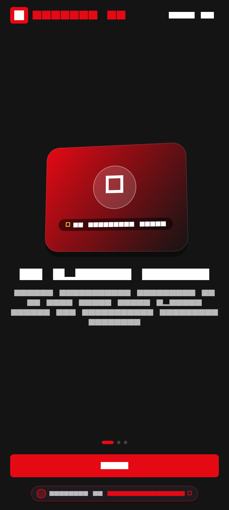
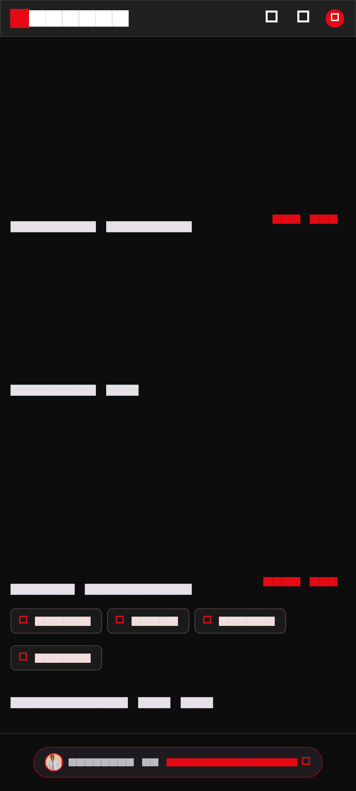
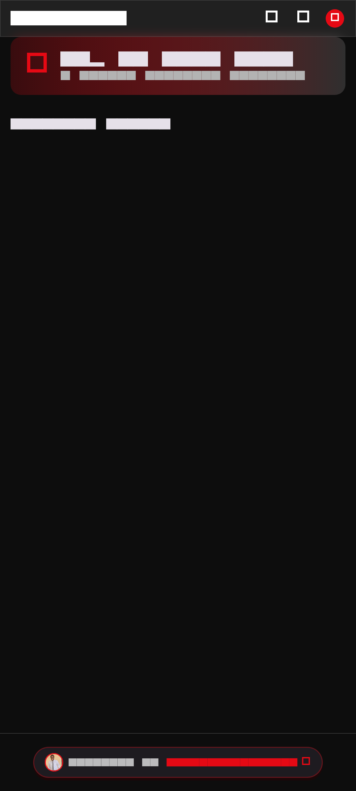
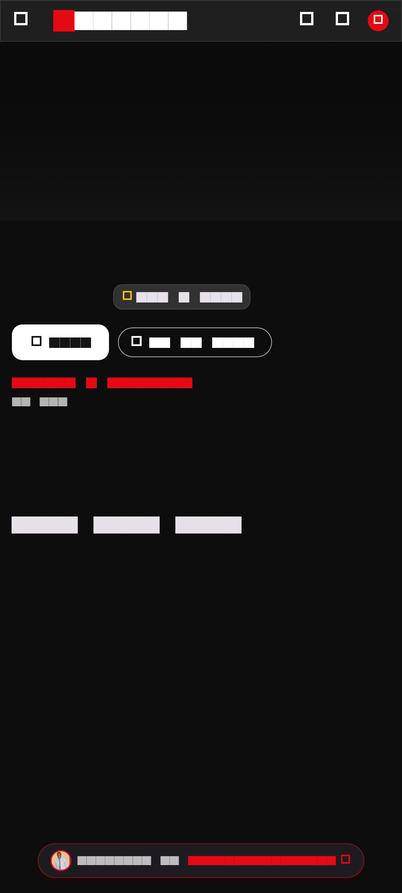
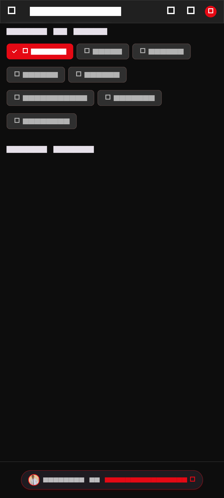
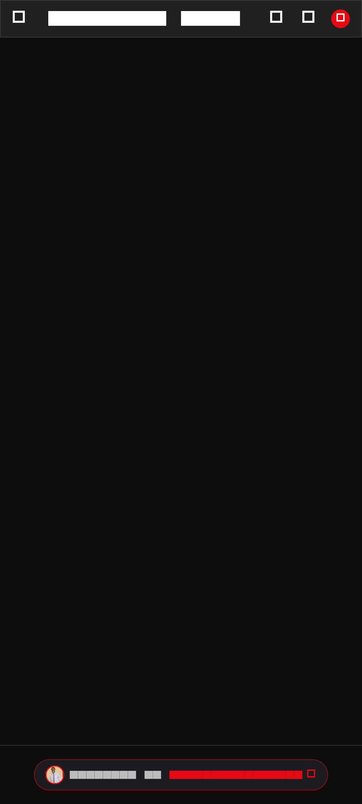
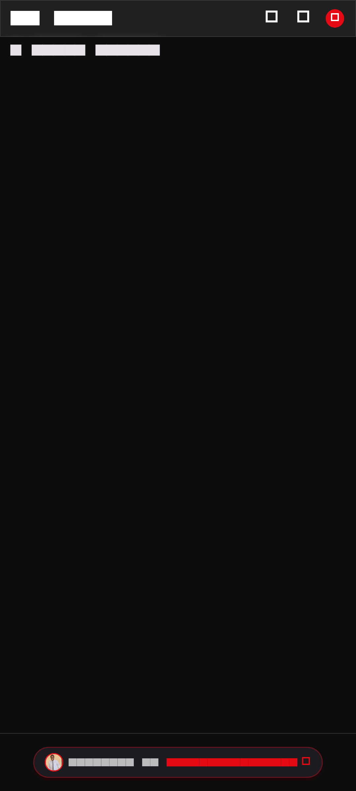
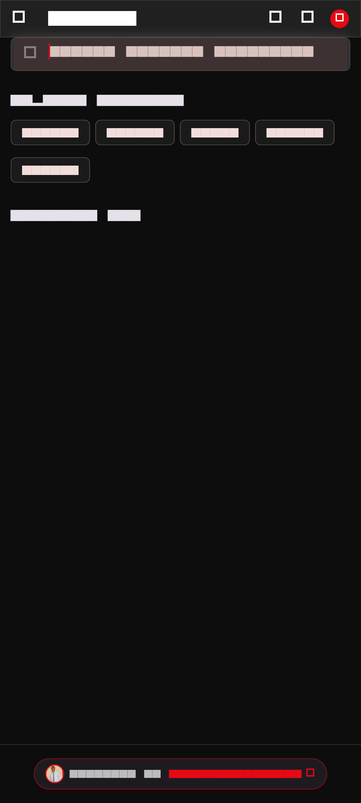
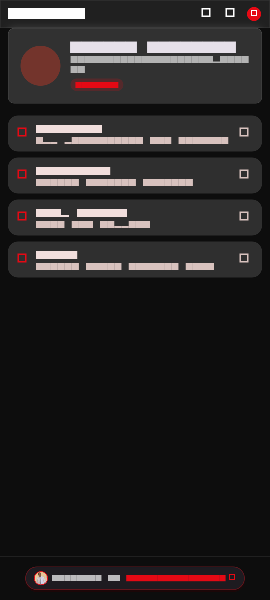
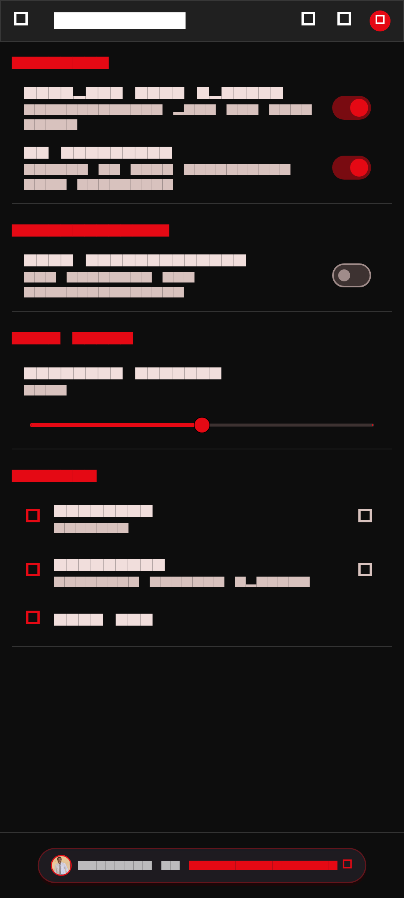

# CineWave 3D - Spatial Cinema & Streaming Theater

<div align="center">

[](https://flutter.dev)
[](https://dart.dev)
[](https://github.com/inusah-ibraheem)
[](https://github.com/inusah-ibraheem)
[](LICENSE)

<p align="center">
  <strong>A cinematic, immersive entertainment hub with 3D billboard carousels, 4K HDR detail sheets, and curated movie hubs.</strong>
</p>

---

</div>

## 🌟 Visual Showcase & Screen Matrix

Every screen in this application has been crafted with custom **3D Spatial Elevation**, dynamic matrix transformations, and authentic domain-specific workflows.

| **01 Welcome** | **02 Home** | **03 Trending** |
| :---: | :---: | :---: |
|  |  |  |

| **04 Movie Details** | **05 Categories** | **06 Continue Watching** |
| :---: | :---: | :---: |
|  |  |  |

| **07 My List** | **08 Search** | **09 Profile** |
| :---: | :---: | :---: |
|  |  |  |

| **10 Settings** |  |  |
| :---: | :---: | :---: |
|  |  |  |


---

## ✨ Key Features & Experience Highlights

- **3D Spatial Cinema Onboarding**: Atmospheric streaming trailer previews and personalized genre selector.
- **Holographic Hero Billboard**: Multi-axis movie posters with high-impact typography and one-tap playback.
- **4K HDR Modal Detail Canvas**: Cast biographies, episode selectors, trailer players, and match percentages.
- **Continue Watching & Custom Watchlists**: Instant resume tracking, offline download managers, and trending rails.
- **Verified Designer Branding**: Stamped with `@inusah_ibraheem` designer badge across all entertainment rails.

---

## 🎨 Design System & Visual Tokens

- **Theme & Aesthetics**: Cinematic True Black & Netflix Red
- **Primary Accent**: `#E50914`
- **Card Technology**: Custom Matrix4 3D Tilt with dynamic specular highlights and multi-stop drop shadows.
- **Typography**: Google Fonts with high-readability spatial weight distribution.
- **Micro-Interactions**: Haptic depth-press reactions, spring-physics curves, and smooth page transitions.
- **Designer Identity**: Certified `@inusah_ibraheem` profile watermark and verification badges.

---

## 🛠️ Architecture & Folder Structure

```text
Netflix Landing UI App/
├── assets/
│   ├── images/
│   │   └── profile.jpg          # Verified Designer Avatar
├── lib/
│   ├── core/                    # Theme, Constants, & Global Tokens
│   ├── features/                # Domain-Driven Screen Modules
│   ├── router/
│   │   └── app_router.dart      # Named Navigation Matrix
│   ├── widgets/
│   │   ├── three_d_card.dart    # Reusable Spatial 3D Card Engine
│   │   └── developer_footer.dart# Verified Designer Footer Widget
│   └── main.dart                # Application Entry Point
├── screenshots/                 # High-Resolution Screen Previews
└── pubspec.yaml                 # Dependency Manifest
```

---

## 🚀 Getting Started

### Prerequisites
- [Flutter SDK](https://flutter.dev/docs/get-started/install) (version 3.19.0 or higher recommended)
- [Dart SDK](https://dart.dev/get-dart)
- Android Studio / VS Code with Flutter Extension
- An active Android/iOS emulator or connected physical device

### Installation & Run

1. **Clone the Repository**:
   ```bash
   git clone https://github.com/inusah-ibraheem/flutter-3d-ui-suite.git
   cd "flutter-3d-ui-suite/Netflix Landing UI App"
   ```

2. **Install Dependencies**:
   ```bash
   flutter pub get
   ```

3. **Run the Application**:
   ```bash
   flutter run
   ```

---

## 👨‍💻 Designer & Author

<div align="center">
  
  <p><strong>Inusah Ibraheem</strong></p>
  <p><em>Creative Mobile Engineer & 3D Flutter Specialist</em></p>
  <p>
    <a href="https://github.com/inusah-ibraheem">GitHub: @inusah_ibraheem</a>
  </p>
</div>

---

## 📄 License

This project is licensed under the MIT License - see the [LICENSE](LICENSE) file for details.
